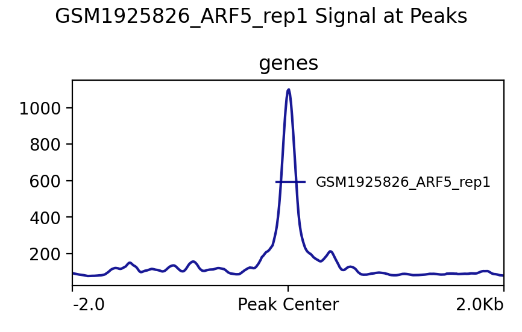
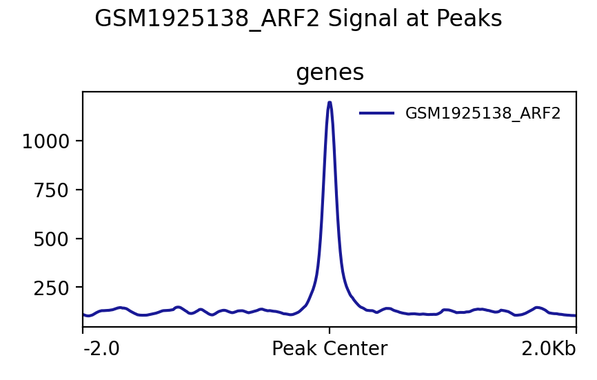
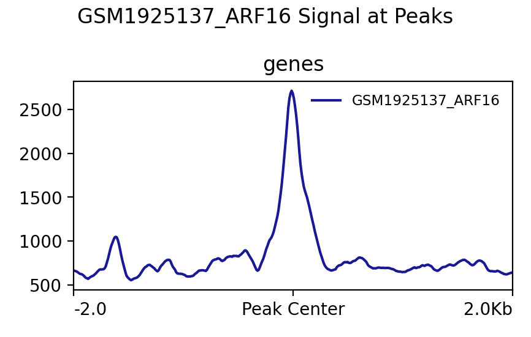
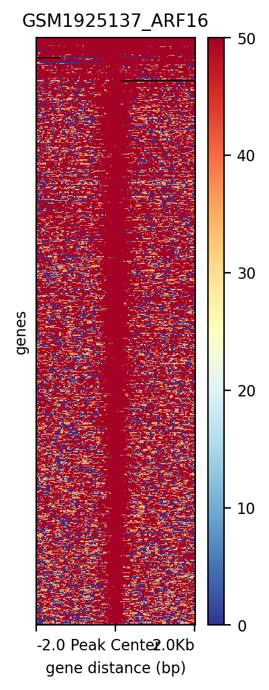

# Example DAP-seq figures

Output from the [`pipelines/dap_seq`](../../../pipelines/dap_seq/README.md)
pipeline (step `4_viz_prep.sh`, deepTools `plotProfile`/`plotHeatmap`),
made by the author from the **public** GSE60141 DAP-seq data (O'Malley et
al. 2016; see [`data/README.md`](../../../data/README.md)). Signal is shown
around peak summits for each transcription factor.

| Figure | Sample |
|---|---|
|  | ARF5/MP replicate 1 (GSM1925826): average profile |
|  | ARF2 (GSM1925138): average profile |
|  | ARF16 (GSM1925137): average profile |
|  | ARF16 (GSM1925137): heatmap |
